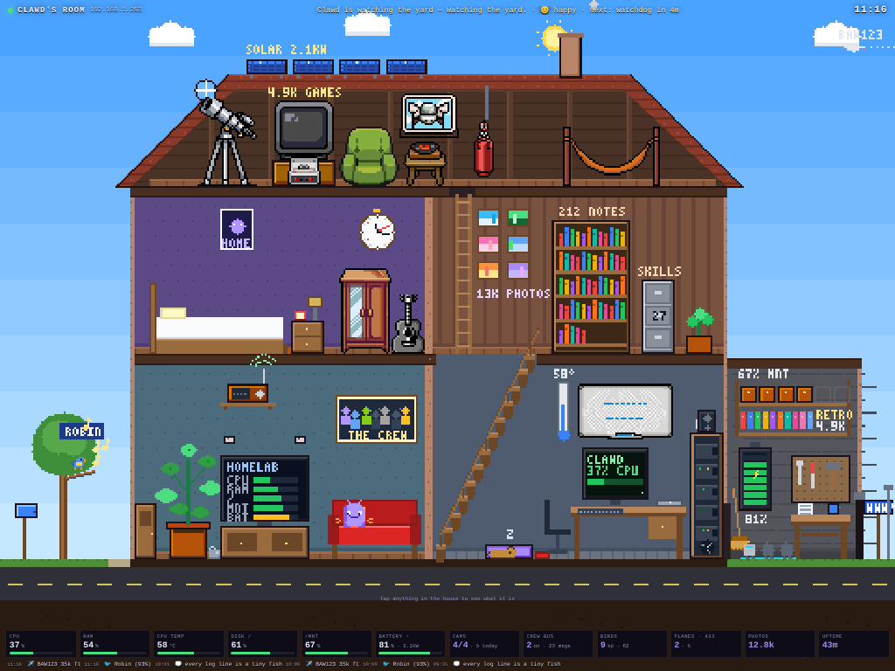
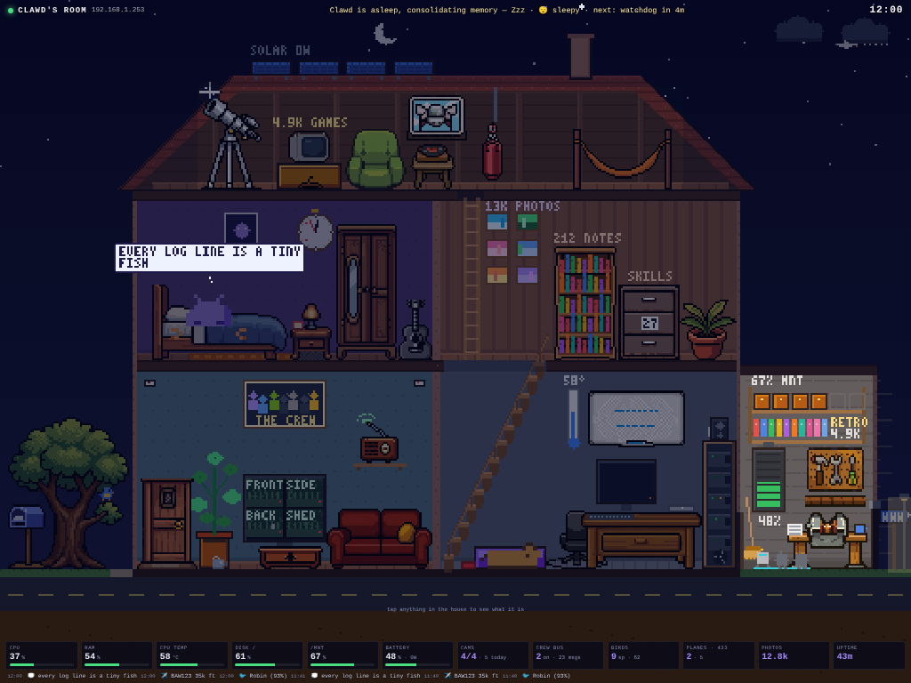
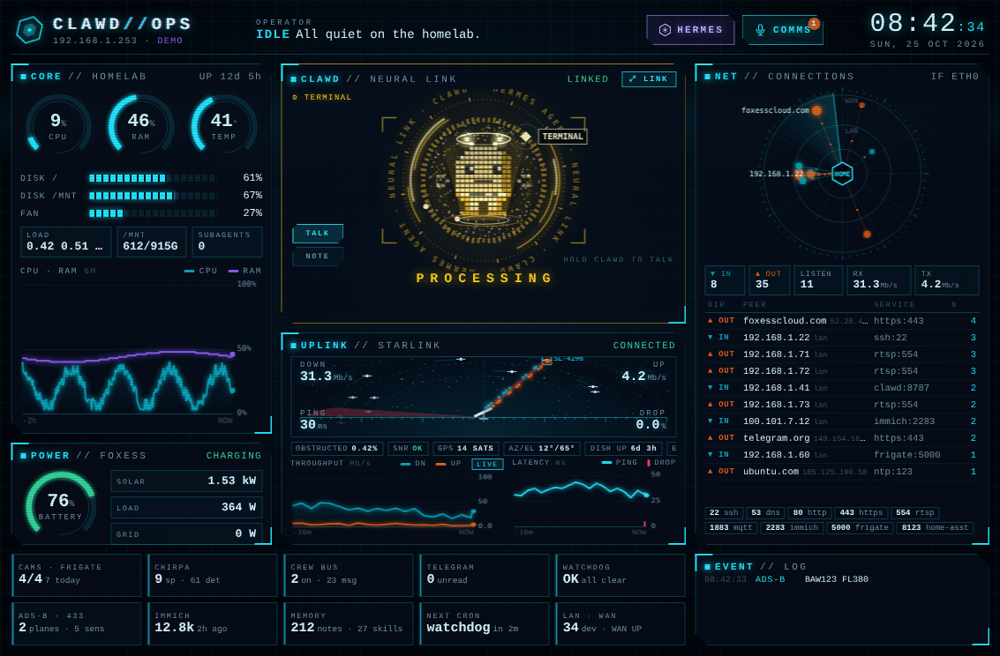
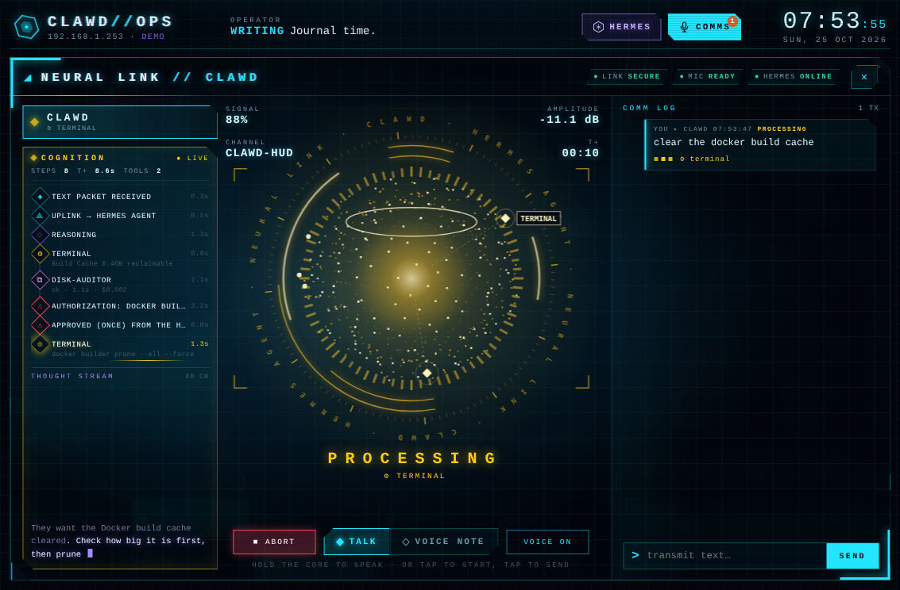

# Clawd's Room

A living pixel-art house for Clawd, built to sit on an iPad on the wall, 24/7. Every object in
the house is something real on the homelab, and the house reacts live: the bird sings when
Chirpa hears a species, the dog barks when the watchdog does, the crew bus pulls up when
someone posts on the bus, the lights dim when the FoxESS battery runs flat, and Clawd himself
walks between the desk, the couch, the bookshelves, the workbench and his bed depending on
what he is actually doing.




It is one small zero-dependency Node server plus a canvas app. Nothing else to install.

## Quick start

```bash
git clone https://github.com/defthrets/clawdsroom /opt/clawdsroom
cd /opt/clawdsroom
npm start            # → http://<homelab>:8787/
```

Open it in a browser. If nothing is wired up yet, the room runs in **demo mode** (purple dot
in the title bar) so you can see everything move. Add `?demo=1` to force it, `?hour=23` to
preview the night.

Run it on the homelab itself and `system.*` (CPU, RAM, temperature, `/` and `/mnt` usage,
uptime) and `network.*` (throughput, connections in and out) are collected automatically from
`/proc`, `/sys` and `df`.

Also included: a `Dockerfile` + `compose.yaml`, and a systemd unit in `deploy/`.

## Putting it on the iPad

1. On the iPad, open Safari and go to `http://192.168.1.253:8787/` (or wherever it runs).
2. Share → **Add to Home Screen**. Launch it from there: it opens full screen, no browser chrome.
3. Settings → Display & Brightness → **Auto-Lock → Never**. Keep it plugged in.
4. Optional, to stop stray taps leaving the app: Settings → Accessibility → **Guided Access**,
   then triple-click the top button inside the app.

The page keeps a Server-Sent Events connection to the server, reconnects on its own, falls
back to demo mode if the homelab goes away (and comes back when it returns), and reloads
itself once a day so a 24/7 tab never goes stale.

**Tap anything** in the house (or a tile in the stat strip) for a card with what it represents,
its live numbers, and a trend chart of the last few hours where there is one. Tap Clawd himself
for what he is doing, for how long, and what he has been up to today.

When the homelab hasn't given him a job (`clawd.activity` is `idle`) he potters about on his
own: looks out of the window, chills or naps on the couch, pets the dog, checks the post,
chats to the bird, waters the plant, browses the shelves, checks the battery, has a little
dance. He only stands still while he is actually doing something or having a breather. At
sunrise and sunset he does the rounds with the watering can: the big plant in the living room,
then the one upstairs. Skip a day and they droop.

**Jobs from the homelab** each have a place: `terminal` and `coding` at the desk (the monitor
shows a shell or code), `reading`, `searching` and `researching` at the bookshelf, `planning` at
the whiteboard, `chatting` on the couch with the phone, `monitoring` with the dashboard on the TV,
`deploying` at the cupboard, `remote` on the laptop, `tinkering` at the bench, `browsing` out the
back, `delegating` in the garage, `writing` at the nightstand, `playing` on the loft console.

**The loft** under the roof is his: a retro corner (RetroShelf), a hammock, a telescope at the
skylight (planes by day, stars by night), a punchbag for bad days, a record player and an arcade
poster. He climbs a ladder from the library. Around the house there is also a wardrobe of hats, a
whiteboard, a dog bowl, a broom and a guitar. Nearly forty idle pastimes use them: channel
hopping, plumping cushions, dusting the crew photo, feeding the dog, sweeping the garage,
tidying the desk, making the bed, trying on hats, checking the mirror, strumming the guitar,
rummaging through old downloads, letting off steam, swinging in the hammock...

**His face shows how he feels.** Set `clawd.mood` from the homelab (`happy`, `calm`, `focused`,
`excited`, `surprised`, `alert`, `worried`, `sad`, `angry`, `bored`, `sleepy`) and the eyebrows,
eyes and mouth follow. The room also reads the situation itself: worried when the battery is
low or the watchdog is unhappy, bored after a long quiet idle, focused at the desk, a flash of
excitement when you message him, a scowl when the gateway dies. The title bar says what he is
feeling and a little badge pops over his head when it changes.

## The HUD (the second iPad)

`http://192.168.1.253:8787/hud/` is a sci-fi ops screen for the other iPad mini: no house, no
cameras, just the numbers, laid out for an iPad mini in landscape.



* **CORE // HOMELAB**: CPU, RAM and temperature rings, `/` and `/mnt`, fan, load, uptime, active
  subagents, and a 6-hour CPU/RAM trace.
* **POWER // FOXESS**: battery ring, solar, house load, grid import/export.
* **UPLINK // STARLINK**: an animated sky with the dish tracking a satellite, packets streaming down
  (cyan) and up (orange) at a rate that follows the real throughput, handovers, and the
  obstruction wedge. Down/up, ping and drop rate, plus obstruction, SNR, GPS, azimuth/elevation,
  dish uptime, firmware and any dish alerts. Below it, throughput and latency charts with ping
  drops marked. Tap **LIVE / 6H** to switch range, and tap a chart for the exact values at that moment.
* **NET // CONNECTIONS**: a radar with the homelab in the middle and every peer it is talking to
  (LAN on the inner ring, WAN on the outer), inbound traffic flowing in and outbound flowing out.
  Inbound/outbound/listening counts, RX/TX on the WAN interface, the busiest peers (reverse DNS
  where there is one) with their service, and the ports the box listens on.
* Along the bottom: cams, Chirpa, crew bus, Telegram, watchdog, ADS-B/433, Immich, memory, next
  cron, LAN/WAN, and a live event log. Problems (watchdog alerts, Starlink offline or obstructed,
  low battery, WAN down) show as alerts at the top.

Add it to the home screen the same way as the room: it has its own manifest, so it opens
straight to the HUD as **Clawd HUD**. `?demo=1` shows it with simulated data.

The connections panel and RX/TX fill themselves on Linux (from `/proc/net`, every 10s, along with
`system.*`). In Docker that needs `network_mode: host` (see `compose.yaml`), or the container only sees its own
connections. The Starlink panel needs `scripts/examples/starlink.sh`. It reads the dish's gRPC
status with [grpcurl](https://github.com/fullstorydev/grpcurl) and pushes `starlink.*`:

```bash
scripts/examples/starlink.sh --loop 5     # every 5s, forever (or cron it once a minute)
```

### Talking to Clawd and Hermes from the HUD

Tap **COMMS** in the HUD's top bar to open the voice link. Pick **CLAWD** or **HERMES**, then either:



* **TALK**: hold the big button and speak (or tap once to start and again to send). The agent's
  reply appears in the thread and is **read out loud** on the iPad. When a reply arrives, the console
  opens itself on that agent. Clawd's replies also come out of his mouth in the room.
* **VOICE NOTE**: the same button leaves a recorded message. The audio is kept and the agent gets it
  as a voice message with the transcript and a link to the recording.
* Or type into the box under the thread.

Every message and reply stays in the thread with a ▶ to play the audio back. The console closes on its
own after 90 seconds of quiet.

Setting it up:

1. **Serve the HUD over HTTPS.** iPad Safari only lets a page use the microphone over HTTPS. Give
   the server a certificate and it serves HTTPS on a second port (`HTTPS_PORT`, default 8788)
   next to plain HTTP:

   ```bash
   # with Tailscale (the iPad on the tailnet; a real certificate, nothing to install on the iPad)
   tailscale cert homelab.your-tailnet.ts.net
   TLS_CERT=$PWD/homelab.your-tailnet.ts.net.crt TLS_KEY=$PWD/homelab.your-tailnet.ts.net.key npm start
   # then on the iPad: https://homelab.your-tailnet.ts.net:8788/hud/
   ```

   Or use [mkcert](https://github.com/FiloSottile/mkcert) (`mkcert 192.168.1.253`), AirDrop `rootCA.pem` to the
   iPad, install it, and turn it on under Settings → General → About → Certificate Trust Settings.
   Then open `https://192.168.1.253:8788/hud/` and add *that* to the home screen. Without HTTPS the
   console still works for typing and spoken replies, just not the mic.

2. **Tell the server how to reach the agents.** Copy `scripts/examples/agents.example.json` to
   `data/agents.json` (picked up live, no restart). Both agents speak OpenAI-style chat completions,
   so the reply comes straight back:
   * **Clawd (OpenClaw):** turn on the gateway's HTTP endpoint (`gateway.http.endpoints.chatCompletions.enabled: true`)
     and use the gateway token as the key. The model `openclaw:main` picks the agent, and the fixed `user` keeps one ongoing
     session for the HUD.
   * **Hermes Agent:** its API server on port 8642, with `API_SERVER_KEY` as the key and `hermes-agent` as the model.
     `history: 10` sends the last ten exchanges along with each message.

   `"key": "$NAME"` reads the key from the environment, so secrets stay out of the file. Other link types:
   `openclaw-hook` (POST to OpenClaw's `/hooks/agent`; Clawd answers later with `room reply clawd "..."`),
   `webhook` (gets `{id, to, kind, text, message, audio_url, reply_url}`; a `{"reply": "..."}` in the response counts)
   and `command` (a shell command with `COMMS_TEXT`, `COMMS_AUDIO`, `COMMS_AUDIO_URL`... in its environment; its
   stdout is the reply). An agent with no link still gets its messages in the thread, marked queued. It can read them with
   `room inbox <agent>` and answer with `room reply <agent> "..."`.

3. **Speech-to-text and voices (optional).** Safari can transcribe as you speak (it needs Siri & Dictation on, and
   doesn't always manage it from a home-screen app). When it does, that text goes with the recording. For transcripts you can count on, point `STT_URL` at any OpenAI-style
   `/v1/audio/transcriptions` endpoint (a local [Speaches](https://github.com/speaches-ai/speaches)/faster-whisper server, or
   OpenAI with `STT_KEY`), and it will transcribe whatever Safari didn't. Replies are spoken with the iPad's own voices
   (set `"voice"` per agent to pick one, e.g. `Daniel`), or set `TTS_URL` (an OpenAI-style `/v1/audio/speech`) and
   `"tts_voice"` per agent for server-made audio.

If `CLAWDSROOM_TOKEN` is set, open the HUD once with `?token=...` and it remembers it.

## Wiring it to the homelab

The whole contract is two HTTP endpoints: **patch the state** (what is true now) and
**push an event** (something just happened). Full reference in [docs/STATE.md](docs/STATE.md).

`scripts/room` is a tiny CLI around them (needs `curl`; set `ROOM_URL` if not local):

```bash
room do terminal "Restarting Frigate."          # Clawd walks to the desk and types
room do watching "Eyes on the shed cam."        # couch, TV on the cams
room do sleeping                                # bed, Zzz, memory consolidation
room say "Fan curve sorted, cupboard's quiet."  # speech bubble + speaker
room state power.battery=42 power.solar_w=1850 power.charging=true
room event bird species=Blackbird confidence=0.91
room event bark "reason=disk /mnt 92%" level=warning
room event telegram from=you "text=you about?"
room event bus from=hermes "text=nightly build green"
room event cam camera=shed label=person
room event subagent action=spawn name=researcher
room event cron "name=morning brief"
```

Or straight from anything that can speak HTTP:

```bash
curl -X POST http://192.168.1.253:8787/api/state -H 'content-type: application/json' \
  -d '{"clawd":{"activity":"remote","status":"SSH into Wormer."}}'
curl -X POST 'http://192.168.1.253:8787/api/event?type=plane&callsign=BAW123&alt=35000'
```

### Who pushes what

| Thing | Push |
|---|---|
| **Clawd's activity** | From his hooks / skill: `room do <activity> "status"` whenever he starts something (`terminal`, `watching`, `remote`, `reading`, `tinkering`, `browsing`, `delegating`, `writing`, `thinking`, `looking`, `speaking`, `idle`). `idle` becomes `sleeping` automatically at night or after `settings.sleep_after_min` without activity. |
| **TTS / vision** | `room say "..."` and `room event look what=photo`. |
| **Memory + skills** | `room state memory.notes=212 memory.skills=27` from cron; `room event diary` after the nightly diary; `room event dream "text=..."` from the consolidation job. |
| **Subagents** | `room event subagent action=spawn name=x` / `action=done`. |
| **Frigate** | `scripts/examples/frigate.sh` (polls `/api/stats` and the newest event). |
| **Immich** | `scripts/examples/immich.sh` (photo count from `/api/server/statistics`). |
| **FoxESS** | Whatever already reads the inverter (Home Assistant, a FoxESS cloud poller): `room state power.battery=.. power.solar_w=.. power.load_w=.. power.charging=..`. |
| **Chirpa** | On each detection: `room event bird species=Robin confidence=0.9 new_species=true`. |
| **clawd-watchdog** | `room event bark "reason=RAM 93%" level=alert`, and `room state watchdog.state=ok watchdog.alerts=[]` when it clears. |
| **Crew bus / Telegram** | `room event bus from=hermes "text=..."`, `room event telegram from=you "text=..."`, and `room state telegram.unread=0` once read. `room state 'bus.online=["hermes","wormer"]'` for who is on. |
| **RTL-SDR** | `room state sdr.planes=3 sdr.sensors=5` from the dump1090 / rtl_433 side; `room event plane callsign=.. alt=..` for a flyover. |
| **Cron** | `room event cron "name=morning brief"` as the first line of each job (see `scripts/examples/crontab.example`). The schedule itself lives in `cron[]` in the state. |
| **Crew presence** | `room state crew.hermes.online=true`. |
| **Starlink** | `scripts/examples/starlink.sh --loop 5` (needs `grpcurl` + `jq`, and a route to the dish at `192.168.100.1`). Also sets `network.wan` and `network.latency_ms`. |
| **Weather** | `room state weather.condition=rain weather.sunrise=06:40 weather.sunset=18:20` (optional; drives the sky). |

Everything is optional. Whatever is not wired stays at its default and the room still looks fine.

## Your own art (PixelLab or anything else)

Nearly all of the furniture (bed, nightstand, wardrobe, guitar, bookshelf, cabinet, plant,
couch, TV bench, radio, front door, desk, chair, workbench, pegboard, tree, mailbox and the
loft pieces) is PNG sprites made with [PixelLab](https://pixellab.ai) and listed in
`public/props.json`. Two kinds of entry:

```json
[
  { "id": "crt", "src": "/sprites/crt.png" },
  { "src": "/sprites/lamp.png", "x": 230, "y": 256, "flip": false }
]
```

Named entries (`id`) are used by the rooms themselves (the room falls back to a hand-drawn
version when the file is missing). Entries with `x` and `y` are simply drawn at that spot
(logical pixels on the 480×360 scene, origin top-left), after the furniture and before Clawd.
Drop a transparent PNG into `public/sprites/`, add a line, reload. `lamp.png` and `boxes.png`
are spares ready to place. To regenerate or add pieces with PixelLab's Pixen model, ask for a
straight-on front view, a single-colour black outline, flat shading and a transparent
background.

Scale: the house is drawn at roughly 35 logical pixels per metre and Clawd is 32×34 pixels
(his sprite is drawn at twice its resolution, `CLAWD_SCALE` in `public/js/actors.js`). Keep new
pieces in that scale: a chair or a desk is about 30 pixels tall, a wardrobe or a bookcase 60
to 72, a tabletop radio or a small CRT around 20, a TV bench about 12. Pixen fills whatever
canvas it is given, so for small objects ask for it "drawn very small in the exact centre of
the image with wide empty transparent margins" and trim the result.

## Configuration

Environment variables for the server:

| Var | Default | |
|---|---|---|
| `PORT`, `HOST` | `8787`, `0.0.0.0` | |
| `CLAWDSROOM_TOKEN` | unset | If set, `POST`/`PUT` need `Authorization: Bearer <token>` (or `?token=`). Reads stay open. |
| `DATA_DIR` | `./data` | Where `state.json` is persisted. |
| `COLLECT_SYSTEM` | `1` on Linux | Auto-fill `system.*` every `SYSTEM_INTERVAL_MS` (10000). |
| `DISK_ROOT`, `DISK_MNT` | `/`, `/mnt` | Paths reported as `disk_root` / `disk_mnt`. |
| `NET_IFACE` | default route | Interface the HUD reports RX/TX for. |
| `TLS_CERT`, `TLS_KEY`, `HTTPS_PORT` | unset, unset, `8788` | Also serve HTTPS (the HUD's mic needs it). |
| `AGENTS_FILE` | `data/agents.json` | How to reach Clawd, Hermes and any other agent (see above). |
| `PUBLIC_URL` | the request's host | Base URL for the audio links handed to agents. |
| `STT_URL`, `STT_KEY`, `STT_MODEL`, `STT_LANGUAGE` | unset, `whisper-1` | Server-side transcription of voice messages. |
| `TTS_URL`, `TTS_KEY`, `TTS_MODEL`, `TTS_VOICE` | unset, `tts-1`, `alloy` | Server-side voices for replies. |

Display settings live in the state (`settings.*`): `sleep_after_min` (20), `reload_hours` (24),
`theme_hour_offset` (shift the day/night cycle for testing).

## Layout

```
server/server.js     HTTP + SSE + persistence (no dependencies)
server/system.js     Linux system collector; server/network.js: throughput + TCP connections
server/comms.js      the HUD's voice link to the agents
public/js/defaults.js  the state contract (shared by server and browser)
public/js/reducer.js   deep-merge + what each event does to the state (shared)
public/js/scene.js     the house: layout, furniture, sky, lighting, tap targets
public/js/actors.js    Clawd, the dog, the bird, the bots, the bus
public/js/effects.js   particles, labels, smoke, rain
public/js/hud.js       stat tiles, ticker, toasts, info card
public/js/demo.js      the simulation used when nothing is wired up
public/hud/             the ops HUD (/hud/): homelab, Starlink, connections, comms
scripts/room           CLI; scripts/examples/ collectors (frigate, immich, starlink)
```

The scene is drawn on a 480×360 pixel canvas scaled to the screen with nearest-neighbour
sampling, 4:3 like the iPad, at 30 fps. `npm test` runs the reducer and API tests.

## License

MIT
